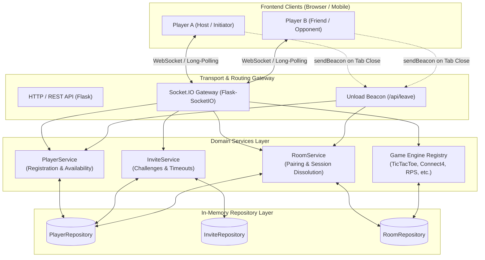
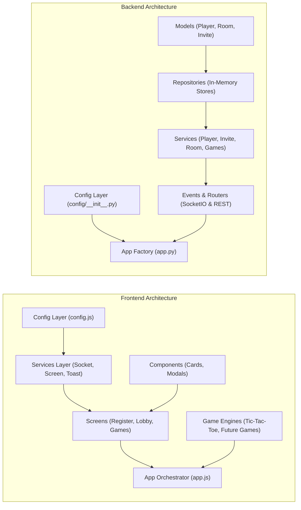
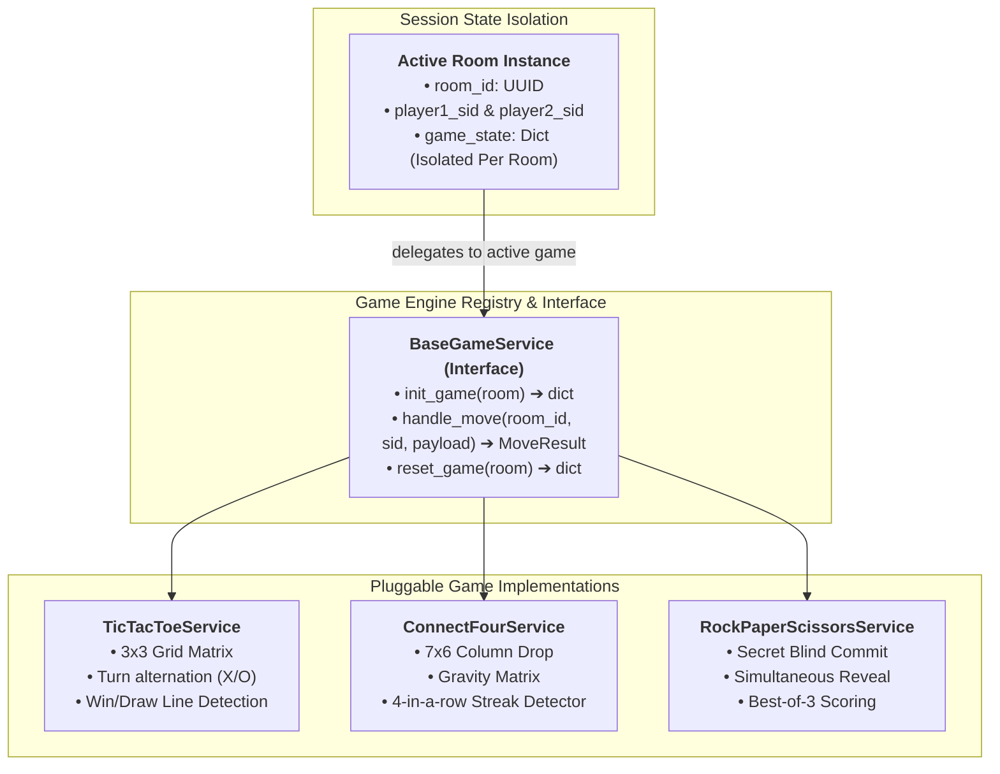
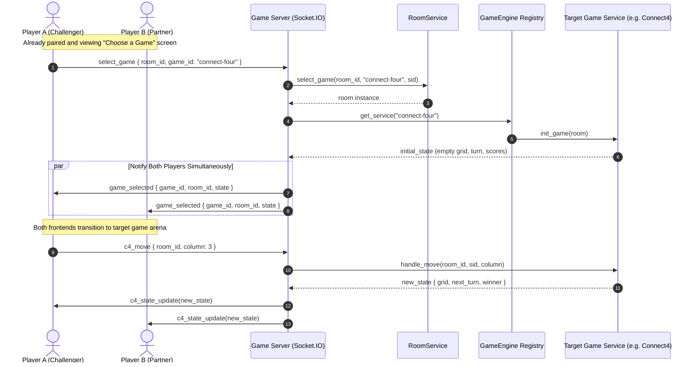
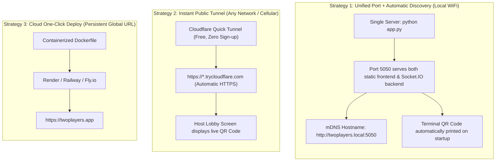

# Two Players — Architecture & Multi-Game Scaling Guide

This document details the system design, modular layers, real-time communication protocols, pluggable multi-game architecture, lifecycle resilience, and zero-configuration ("No-IP") deployment strategies for the **Two Players** local multiplayer gaming platform.

---

## 1. High-Level Architecture Overview



---

## 2. Layered Architecture

Both frontend and backend follow strict separation of concerns:



### Backend Layers
1. **Models Layer (`backend/models/`)**: Pure dataclasses defining domain entities (`Player`, `Room`, `Invite`). No dependencies on Flask or databases.
2. **Repository Layer (`backend/repositories/`)**: Abstracted collections (`PlayerRepository`, `InviteRepository`, `RoomRepository`) that handle thread-safe state in memory. Easily swappable for Redis in clustered environments.
3. **Service Layer (`backend/services/`)**: Core business rules (`PlayerService`, `InviteService`, `RoomService`, `TicTacToeService`). Validates moves, alternates turns, detects victories/draws, and enforces pairing lifecycles.
4. **Events & Routers Layer (`backend/events/`, `backend/routers/`)**:
   - `events/`: Handles real-time Socket.IO events (`connect`, `disconnect`, `register`, `send_invite`, `select_game`, `ttt_move`, `leave_pair`).
   - `routers/`: REST endpoints like `/health` and `POST /api/leave` for high-reliability tab close beacons.
5. **App Factory (`backend/app.py`)**: Dependency-injection container wiring config, repos, services, and routers together into a Flask + Flask-SocketIO runtime.

### Frontend Layers
1. **Config (`frontend/js/config.js`)**: Dynamic server discovery (`window.location.hostname`), polling transport rules, and timeout constants.
2. **Services (`frontend/js/services/`)**:
   - `socket-service.js`: Singleton managing the connection lifecycle and queuing early event listeners.
   - `screen-manager.js`: Single-page app transition controller with history support.
   - `toast-service.js`: Non-blocking glassmorphism notifications.
3. **Components (`frontend/js/components/`)**: Modular render functions for Player cards, Game cards, and Challenge modals.
4. **Screens (`frontend/js/screens/`)**: View controllers managing user interactions on Register, Lobby, and Game Selection screens.
5. **Game Arenas (`frontend/js/games/`)**: Self-contained interactive controllers for each game (e.g. `tic-tac-toe.js`).

---

## 3. Pluggable Multi-Game Architecture

The system is designed so that adding a new multiplayer game (e.g., Connect Four, Rock-Paper-Scissors, Battleship, Memory Match) requires **zero changes to core infrastructure**.



### Multi-Game Flow Sequence



### Adding a New Game in 4 Steps:
1. **Catalog Entry (`frontend/js/data/games-catalog.js`)**: Add game metadata (`id`, `title`, `description`, `minPlayers`, `badge`).
2. **Backend Service (`backend/services/<game>_service.py`)**: Implement `init_game`, `handle_move`, and `reset_game`.
3. **Backend Event Handler (`backend/events/<game>_events.py`)**: Wire socket events (e.g., `<game>_move`, `<game>_restart`).
4. **Frontend Game Arena (`frontend/js/games/<game>.js`)**: Create the UI controller and register its screen in `screen-manager.js`.

---

## 4. Lifecycle & Edge-Case Resilience

The platform distinguishes between **leaving a match voluntarily** versus **closing the tab / network drop**.

```mermaid
sequenceDiagram
    autonumber
    actor PlayerA as Player A
    actor PlayerB as Player B
    participant Frontend as Browser / Window Lifecycle
    participant Server as Server & Socket.IO
    participant Repo as PlayerRepository

    rect rgb(20, 40, 20)
        Note over PlayerA,PlayerB: Scenario 1: Voluntary Exit ("Back" or "Leave Game")
        PlayerA->>Server: emit('leave_pair')
        Server->>Repo: room_service.leave_pair(sid)
        Note over Server,Repo: Both Player A & B statuses reset to "available"
        Server->>PlayerA: emit('left_pair')
        Server->>PlayerB: emit('partner_left', { name: "Player A" })
        Server->>Server: broadcast('player_list')
        Note over PlayerA,PlayerB: Both return to Lobby with "Available" status.<br/>Ready to challenge or accept another game immediately.
    end

    rect rgb(45, 20, 20)
        Note over PlayerA,PlayerB: Scenario 2: Player A Closes Tab / Device Dies
        PlayerA->>Frontend: Closes Tab / Window (pagehide / beforeunload)
        Frontend->>Server: navigator.sendBeacon('/api/leave', { sid })
        Note over Server: Server executes teardown_player_connection(sid) immediately
        Server->>Repo: player_service.unregister(sid)
        Server->>Repo: room_service.cleanup_for_player(sid)
        Server->>PlayerB: emit('partner_disconnected', { name: "Player A" })
        Server->>Server: broadcast('player_list') without Player A
        Note over PlayerB: Player B returned to Lobby with "Available" status.<br/>Player A is completely OFFLINE and removed from player list.
    end
```



---

## 5. Zero-Configuration / "No-IP" Deployment Strategy

Typing manual IP addresses like `http://192.168.1.142:3000` is tedious, error-prone, and fails when router subnets change. Here is the comprehensive roadmap for friction-free, zero-IP setup:



### Detailed Deployment Methods

#### Method 1: Unified Single-Server Mode (Local WiFi, 1 Command)
Currently, frontend and backend run on separate ports (3000 and 5050). By having Flask serve the `frontend/` directory statically:
```python
app = Flask(__name__, static_folder='../frontend', static_url_path='')
@app.route('/')
def serve_index():
    return send_from_directory(app.static_folder, 'index.html')
```
- **Benefit**: Both players connect to a single port (5050). No CORS configuration, no second terminal.

#### Method 2: mDNS / Bonjour Local Domain (`.local`)
All modern operating systems (macOS, iOS, Android 12+, Windows 10/11, Linux Avahi) support Multicast DNS (RFC 6762).
- When starting the server: advertise service as `twoplayers.local`.
- Players simply open: `http://twoplayers.local:5050`
- **Benefit**: Nobody ever looks up or types an IP address!

#### Method 3: Instant Terminal & Lobby QR Code
Using `qrcode` in Python:
```python
import qrcode
qr = qrcode.QRCode()
qr.add_data(f"http://{local_ip}:5050")
qr.print_ascii()
```
- When the host runs `python app.py`, a high-contrast QR code is rendered right in their terminal and displayed on the Host's Lobby header.
- **Player B simply scans the screen with their phone camera** and is instantly in the game within 1 second.

#### Method 4: Cloudflare Quick Tunnel (Cross-Network / Remote Play)
To play with a friend without being on the same WiFi router, or when router AP client isolation is enabled:
```bash
# Free zero-setup tunnel (no account needed)
cloudflared tunnel --url http://localhost:5050
```
- Cloudflare outputs a public HTTPS link: `https://play-two.trycloudflare.com`.
- Works across cellular data, university WiFi, hotel networks, and firewalls with full WebSocket support.

---

## 6. Real-Time Protocol & Event Contracts

| Event Name | Direction | Payload Schema | Purpose |
| :--- | :--- | :--- | :--- |
| `register` | Client → Server | `{ "name": "Alice" }` | Registers nickname with server validation |
| `registered` | Server → Client | `{ "id": "sid_123", "name": "Alice" }` | Confirms local player registration |
| `player_list` | Server → All | `[ { "id": "sid_1", "name": "Bob", "status": "available" } ]` | Broadcasts live online player statuses |
| `send_invite` | Client → Server | `{ "target_id": "sid_2" }` | Sends 1v1 challenge to a player |
| `invite_received`| Server → Target | `{ "from_id": "sid_1", "from_name": "Alice" }` | Prompts challenge modal on target player |
| `accept_invite`| Client → Server | `{ "from_id": "sid_1" }` | Accepts match challenge |
| `paired` | Server → Both | `{ "room_id": "r_1", "player1": {...}, "player2": {...} }` | Initializes paired room session |
| `select_game` | Client → Server | `{ "room_id": "r_1", "game_id": "tic-tac-toe" }` | Selects game from catalog |
| `game_selected`| Server → Both | `{ "game_id": "...", "room_id": "...", "state": {...} }` | Launches game arena simultaneously |
| `leave_pair` | Client → Server | `{}` | Voluntarily leaves match; resets both to Available |
| `partner_left` | Server → Partner| `{ "name": "Alice" }` | Notifies partner and returns to Lobby as Available |
| `POST /api/leave`| Beacon → Server| `{ "sid": "sid_123" }` | Immediate tab close notification; marks Offline |
| `partner_disconnected`| Server → Partner| `{ "name": "Alice" }` | Notifies remaining player of tab closure |
